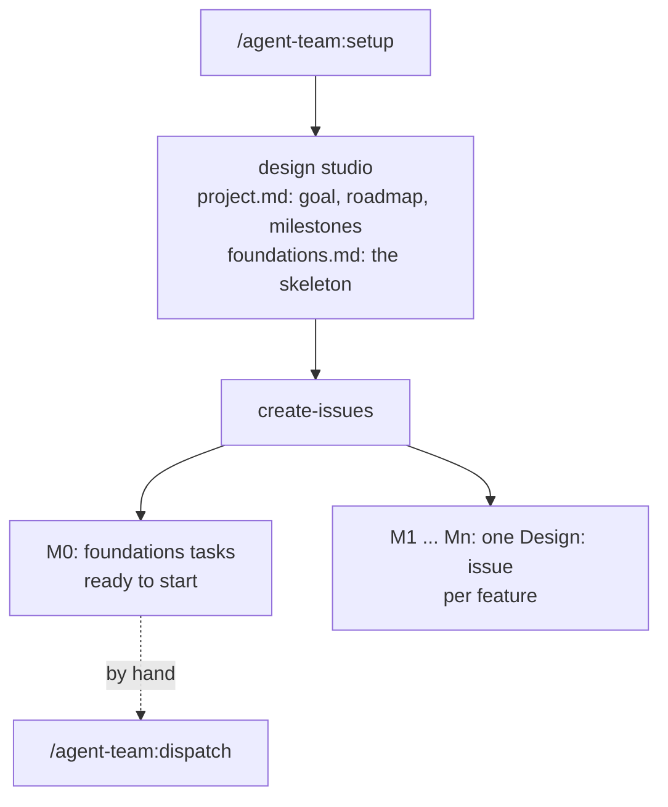
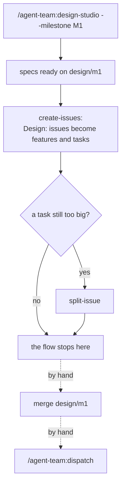
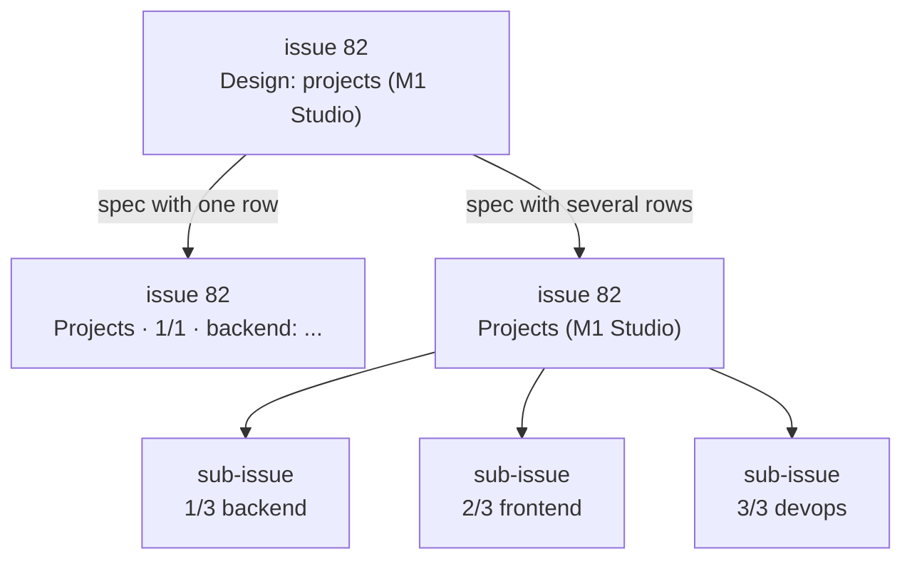
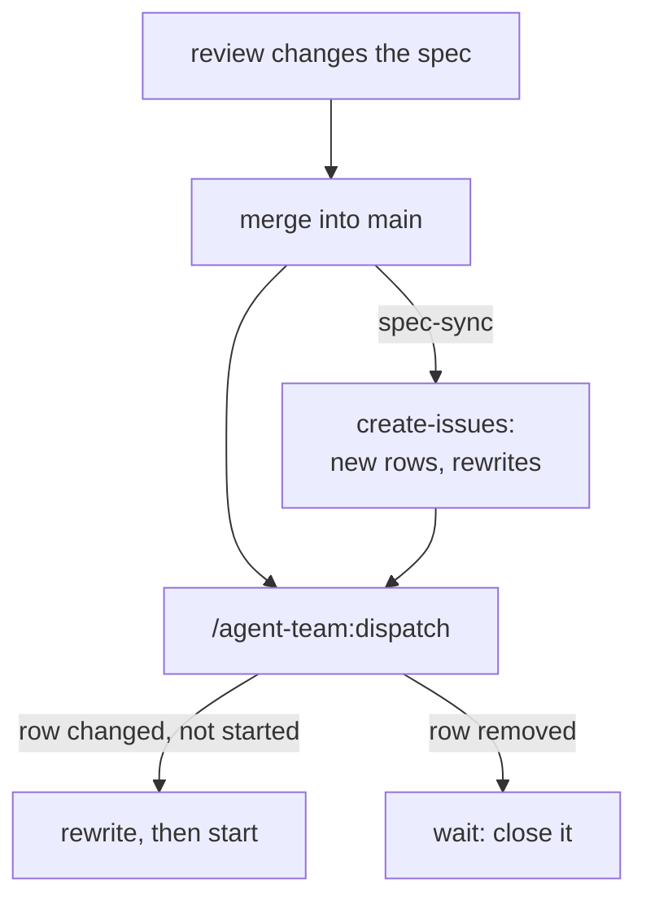

# 4. Run the project

<!-- nav -->
[← 3. Set up a project](03-set-up-a-project.md) · [Manual index](README.md) · [5. Scenario: local →](05-scenario-local.md)
<!-- /nav -->

This chapter is the same in every scenario: how you design, plan, start,
review and keep the team aligned. The scenario chapters only add how agents
run and how a task starts.

## The workflow

A project goes through two flows. The first runs once, at the start. The
second runs for every feature or milestone, as many times as the roadmap needs.
In the diagrams, solid arrows are steps the command does; dashed arrows,
"by hand", are yours.

**1. Start: setup, project design, issues.**



**2. Every feature or milestone: design, issues, split, dispatch.**



Each step is also a command of its own, and each one shows its plan and waits
for your yes. To run a whole flow in one go, add `--to-issues`:

```text
/agent-team:setup --to-issues                          flow 1, up to the issues
/agent-team:design-studio --milestone M1 --to-issues   flow 2, up to the split
/agent-team:design-studio audit-log --to-issues        flow 2 for one feature
```

Both stop before dispatch: starting agents costs tokens or quota
([9. What a run costs](09-reference.md#what-a-run-costs)), so you start them
yourself. The split step is proposed by the agent only for a task that still
spans several roles or is too big for one merge request, and you approve it
per issue. They do not wait for the merge of the design (or setup)
merge request: the issues are created from its branch, and dispatch keeps a
task waiting, with "spec ... not merged", until its spec is ready on the main
branch, where the agents read it.

### Example: milestone M1, from Design: issues to running tasks

Milestone M1 (named "Studio") has two "Design:" issues, #82 `projects` and
#83 `providers-and-models`:

```text
> /agent-team:design-studio --milestone M1 --to-issues
  Scope: projects, providers-and-models (no spec yet). Go on?
> yes
  (drafts both specs from project.md, then one round of questions)
  Q1 - projects: clone over HTTPS with a GitHub App token? Recommended: yes
  Q2 - providers-and-models: Anthropic API first, others later? Recommended: yes
  ...
> 1 yes, 2 yes, 3: option B
  ...
> ok projects; ok providers-and-models
  Committed on design/m1, merge request opened.
  create-issues (dry run):
    rename  #82  Design: projects (M1 Studio)  ->  Projects (M1 Studio)
    create        Projects · 1/3 · backend: Repository model and API   (sub-issue of #82)
    create        Projects · 2/3 · frontend: Projects page              (sub-issue of #82)
    create        Projects · 3/3 · devops: GitHub App secrets in CI     (sub-issue of #82)
    rename  #83  Design: providers-and-models (M1 Studio)  ->  Providers and models · 1/1 · backend: Provider settings
> yes
  Split: none of the new tasks needs it.
  No dependencies: #103 backend, #105 devops, #83 backend.
  Merge the design merge request, then /agent-team:dispatch.
> /agent-team:dispatch                (before the merge)
  Waiting: #103, #105, #83 - spec docs/design/projects.md not merged into origin/main yet ...
  (you merge the merge request)
> /agent-team:dispatch
  Would start (2): #103 backend, #105 devops
  Waiting: #104 (needs #103), #83 (a backend task is already running)
```

## Design

Large decisions are made in a design studio session between you and the
designer, never in the middle of a task:

```text
/agent-team:design-studio login        (Claude Code, with the plugin)
/design-studio login                   (Claude Code or OpenCode, in the project)
use the design-studio skill for login  (Codex)
```

The three run the same procedure, `docs/roles/design-studio.md` in your
project. `/agent-team:design-studio` is the plugin's command: use it when you
have the plugin, since only it has `--to-issues`. `/design-studio` is the
project's own copy, there for people who work without the plugin.

The designer asks in rounds of at most five numbered questions, each with a
recommended answer, so you can reply in one line ("1 yes, 2 yes, 3: option B").
Facts it can find in the repository, it looks up instead of asking. The rounds
go from goal and user flows to screens, data and API, **test seams** (the
interfaces the tests go through), the **task breakdown** and a readiness check.

The result is a spec, `docs/design/<feature>.md`, written as the session goes,
so you can stop and resume. The designer sets `ready: yes` in its first lines
only when no question is left open and you agree. Its task breakdown lists one
row per task: role, what, dependencies. The first session of a project writes
`docs/design/project.md`, whose roadmap lists the milestones (`M0`, `M1`...)
and the features in each.

When the spec is ready, the designer commits it on a branch `design/<feature>`
and, if the repository has a remote, opens a merge request `design: <feature>`
for you to review and merge. Without a remote, merge the branch yourself.

### A whole milestone at once

The project session writes only `project.md`: the goal, the decisions and a
roadmap of features. Every feature still needs its own spec, and until it has
one `create-issues` makes a `Design: <feature>` issue for it, which dispatch
never starts. To design all the features of a milestone in one session:

```text
/agent-team:design-studio --milestone M0
```

- It lists the features of M0 without a ready spec and asks for a yes.
- Before asking anything, it drafts every spec from what is already decided:
  the roadmap, `project.md`, earlier specs, the code. It asks only about what
  is left open.
- Each round covers all the features, at most twelve questions, prefixed by
  feature ("Q3 - auth-and-users: session length"). A decision that concerns
  several features is asked once.
- The breakdowns are planned together: the API contract or a shared
  component is a row of one spec only, and a row that needs a row of another
  spec says `app-shell#2` in "Depends on". `create-issues` creates that issue
  first and links the two.
- You approve each spec on its own ("ok app-shell; auth-and-users: two
  roles"). The ready specs are committed together on `design/m0`.

Then `/agent-team:create-issues` turns the "Design:" issues of M0 into
features and tasks ([Issues](#issues)), and `/agent-team:dispatch` starts
them once the specs are merged. With `--to-issues` the design studio runs
those steps itself, up to dispatch ([The workflow](#the-workflow)).

### Specs and hand-written issues

Agents implement only what a ready spec covers. A task whose spec is missing,
not ready, or silent on what it is asked to do stops: it writes what is
missing in the issue (in CI) or tells the main session (locally), and invents
nothing. This does not mean every issue comes from `create-issues`: a bug fix
or a small change to a feature that already has a spec is covered by it, and
a hand-written issue that names the spec is a fine task. New behavior needs a
design first.

Run the design studio again to revise a spec: past decisions are kept, and
rows that already have an issue are not rewritten; new work becomes new rows.

## Issues

With a tracker, the roadmap and the ready specs become issues. Without one
(`"tracker": "none"`) there are no issues: the rows of the task breakdown are
the tasks, and you ask the main session for them ("implement task 2 of
docs/design/login.md").

```text
/agent-team:create-issues       or      python3 scripts/create-issues.py --dry-run
                                         python3 scripts/create-issues.py
```

- one **milestone** per roadmap milestone (a version in Jira and Redmine, a
  project milestone in Linear);
- in it, one **issue per row** of every ready spec's breakdown, with the
  role, the spec, the acceptance criteria and the dependencies;
- one **`Design: <feature>`** issue for every feature that has no spec yet.

When a feature that has a "Design:" issue gets its ready spec, that issue is
not left behind:



- one row: the issue is renamed and rewritten as that task, ready to start;
- several rows: it becomes the feature issue, and the tasks are created as its
  sub-issues (GitLab: linked issues; Jira: Tasks with a "Relates" link, so that
  each can still be split into sub-tasks). The feature issue is
  not a task: dispatch never starts it.

A task that is still too big for one merge request is split afterwards
([Split](#split)).

`create-issues` shows the plan first and creates only on your yes. It adds no
labels, so nothing starts on its own. Running it again creates only what is
missing, so run it after every design session. With `--team`, a spec whose
breakdown ends with "Team task possible: yes (roles: ...)", a line the
designer writes for small, tightly coupled features, becomes one
[team task](#team-tasks) instead of one issue per task.

### When a spec changes after its issues exist

Issues can be created before the design merge request is merged
([The workflow](#the-workflow)), so the spec can still change: a reviewer asks
to merge two tasks, drops the devops row, fixes a dependency, or you reread it
and correct a row. Every task issue carries a fingerprint of its row
(`spec-row: ...`, in a hidden marker), so the change is never missed:

| The row... | Task not started yet | Task already started |
|---|---|---|
| changed | the issue is rewritten from the row: title, text, dependencies | left alone and listed: check the work against the spec, or stop it |
| removed | the task waits, and the issue is listed to close (never closed for you) | listed |
| added | a new issue | - |

Who applies it:

- **dispatch, always.** Before starting anything it compares each task with
  its row on the main branch. A changed row rewrites the issue first ("Would
  update", applied with your yes), then the task is judged on its new
  dependencies; a removed row keeps it waiting. So no task ever starts on an
  outdated spec, with any tracker and in any scenario.
- **create-issues**, whenever you run it: new rows, and the same rewrites.
- **The `spec-sync` feature**, if you want it automatic: create-issues runs by
  itself, without asking, every time a change to `docs/design/` reaches the
  main branch. It only creates and rewrites issues of tasks not started; it
  never closes or starts one.



| Where | spec-sync runs as |
|---|---|
| GitHub | `.github/workflows/spec-sync.yml`, on every push to the default branch that touches `docs/design/` |
| GitLab | the `spec-sync` job in `.gitlab/ci/spec-sync.yml` (included by `.gitlab-ci.yml`), same rule; needs `GITLAB_ACCESS_TOKEN` ([6. GitLab](06-scenario-remote.md#gitlab)) |
| Local | `scripts/git-hooks/spec-sync.sh`, linked as the Git hooks `post-merge` and `post-commit` ([5. Scenario: local](05-scenario-local.md#keep-the-issues-in-line-with-the-specs)) |
| Custom | your orchestrator runs `python3 scripts/create-issues.py` after it merges a change to `docs/design/` |

With Jira, Linear or Redmine the CI job needs the tracker's credentials, the
same as dispatch. Rows keep their numbers: add new tasks as new rows at the
end; renumbering rows makes every following issue "changed".

Supported trackers: GitHub, GitLab, Jira, Linear, Redmine, and plain Markdown
files in `docs/tasks/` (`"tracker": "local"`). A local issue is one file per
issue, which you can also write or edit by hand:

```text
---
id: 14
title: "Login · 1/2 · backend: Auth endpoint"
state: "open"
milestone: "M1 · Login"
labels: []
parent: null
depends: []
---
## Spec
docs/design/login.md - section: Task breakdown, row 1
...
```

That is `docs/tasks/014-login-1-2-backend-auth-endpoint.md`. The values are
JSON. `state` is `"open"`, `"done"` (completed) or `"dropped"` (not planned):
to close the issue, set it to `"done"`. `labels` gets `"agent:<role>"` when
the task starts, and `"hold"` keeps it waiting; `depends` lists the issue
numbers it waits for; `parent` is the issue it is part of. Check the connection to
any tracker before the first run:

```bash
python3 scripts/tracker.py check     # which tracker, authenticated, readable; writes nothing
python3 scripts/tracker.py list      # open issues: role, milestone, dependencies, started or not
```

Credentials come from environment variables, never from files:
`JIRA_EMAIL` and `JIRA_API_TOKEN` (or `JIRA_PAT`), `LINEAR_API_KEY`,
`REDMINE_API_KEY`; `gh` or `glab` must be logged in for GitHub and GitLab.

## Split

An issue written by hand ("orders: filter by date") often needs several
roles. Splitting turns it into one task issue per role, as sub-issues in the
same milestone:

```text
/agent-team:split-issue 42
```

The agent reads the issue, the spec and the existing sub-issues, and proposes
a plan: a table of tasks with role, dependencies, acceptance criteria and the
folders each one touches. You change it in the conversation until it is right.
Only after your yes, the plan is posted on the issue and a script creates
exactly those issues: the model does not create anything itself. Running it
again creates nothing new.

### Several issues at once

Give several numbers, or a milestone (its open issues that have no sub-issues,
are not "Design:" issues and were not made by `create-issues`):

```text
/agent-team:split-issue 12 15 18
/agent-team:split-issue --milestone M1
```

The agent reads all of them first, with the specs and the existing sub-issues,
so the plans fit: no work twice, and the API contract is planned once. It
shows one overview: a table per issue (role, task, depends on), the
dependencies between issues, then numbered questions with a recommended
answer. You approve per issue, in one line:

```text
ok 12, 15; 18: merge the two frontend tasks
skip 21
```

Only what you asked is revised, and the overview is shown again until each
issue is approved or skipped. Then the issues are created in dependency order,
each one with its own proposal comment and its own `create`.

Behind the table you approve there is a plan in JSON, which the agent writes
and checks with `scripts/split-issue.py`; you do not need to edit it, and it
is posted on the issue with the proposal ("Plan data"), so the decision stays
on record. Each task in it has a short `key` (`api`, `ui`), its name inside
the plan. A task can wait for a task of another issue: `"depends_on": ["12:api"]`
means the task `api` of the plan of issue 12. It is written in "Depends on"
and as the tracker's native "blocked by" relation. If that task does not exist
yet, `create` refuses and creates nothing: split issue 12 first. When the
split runs in CI (the `agent:split` label on GitHub, a pipeline on GitLab),
each issue is still proposed and approved on its own.

In the remote scenario you can also split from the issue itself
([6. Scenario: remote](06-scenario-remote.md#split-from-the-issue)).

## Start

A task can start when every task it depends on is **done**: its issue closed
as completed. On GitHub and GitLab that happens when you merge its merge
request, which ends with `Closes #<issue>`. On Jira, Linear, Redmine and local
files you close the issue yourself after the merge (or your tracker's own Git
integration, or your orchestrator, does it). An issue closed as "not planned"
or "won't do" is not done: what depends on it keeps waiting.

You can start tasks one by one, or let dispatch pick the ready ones:

```text
/agent-team:dispatch        or      python3 scripts/dispatch.py           (the plan)
                                     python3 scripts/dispatch.py --apply   (start it)
```

Dispatch takes the first milestone that has open task issues, counts what is
running, and starts the tasks whose dependencies are all closed as completed:
by default one per role and three in total (`--per-role`, `--max`). It never
starts optimizer or security, "Design:" issues, or issues on hold (the `hold`
label; on Redmine, the status set as `hold_status`).

A task whose spec is not ready on the main branch yet waits with "spec ...
not merged": the remote's default branch, fetched first, or the current commit
in a repository without a remote. So issues can be created from a design
branch before its merge request is merged, and nothing starts too early. A
task whose row changed since its issue was written is rewritten first
("Would update"), one whose row was removed waits
([When a spec changes](#when-a-spec-changes-after-its-issues-exist)).

"Design:" issues and issues without a role are not tasks yet. Under "Not tasks
yet" the plan lists how many are open in that milestone and the earlier ones,
with the command that turns them into tasks (`design-studio` then
`create-issues`, or `split-issue`). So if dispatch works on M2 while M0 still
has "Design:" issues, the plan says so.

What "start" means depends on the scenario: a label that starts a CI job, a
GitLab pipeline, a command of your orchestrator, or a printed instruction for
a local session. That is the *starter* ([9. Reference](09-reference.md#starters)).
Either way the task is marked as started (the `agent:<role>` label), so
dispatch does not start it twice.

## While a task runs

| You want to | Local | GitHub | GitLab |
|---|---|---|---|
| follow it | watch the session | the plan the agent comments on the issue, then the Actions run | the job log |
| correct it while it works | tell the session | not possible: the run is unattended; let it finish, then iterate on the merge request | same as GitHub |
| iterate on its merge request | ask the session, on the task's branch | a comment `@claude <what to change>` on the pull request (or on a line of its diff): Claude changes that branch | run the agent pipeline again on the merge request's branch, with `AI_FLOW_INPUT` saying what to change |
| fix a red CI or an outdated branch | ask the session | `@claude fix the failing checks` or `@claude update the branch from main`, or GitHub's "Update branch" button | as for iterating |
| stop it | interrupt the session (Esc in Claude Code) | cancel the run in the Actions tab | cancel the job |
| retry it | ask again | remove the `agent:<role>` label and add it again | run the pipeline again |
| reject the work | discard the branch | close the pull request without merging; the issue stays open | close the merge request |

Each `@claude` comment is one more agent run (up to 15 turns). Plain review
comments and "request changes" do not start anything: the comment must
mention `@claude`. On a pull request opened by Codex or OpenCode, `@claude`
works if Claude Code is one of the project's tools; otherwise check out the
branch and iterate in your local session. In the custom scenario these
actions are your orchestrator's.

After a rejected or stopped run, the issue is still marked as started: remove
`agent:<role>` before starting it again or letting dispatch pick it up.

## Change the plan

- **Pause a task**: add `hold`; dispatch skips it until you remove it.
- **Drop a task**: close its issue as not planned. Tasks that depend on it
  keep waiting, so drop or rework them too.
- **Change what a task does**: change its row in the spec (a design studio
  revision); its issue is rewritten if it has not started
  ([When a spec changes](#when-a-spec-changes-after-its-issues-exist)).
- **Do something first**: dispatch follows issue order and dependencies;
  start the task you want by hand (its label, or by asking the session), or
  add a dependency in the spec.

## Review and merge

Every merge request describes itself in the same sections:

- **Summary**: what changed and why.
- **Evidence**: before and after; screenshots for UI changes.
- **Merge danger**: can it simply be reverted, or does it migrate data or
  break a client; who feels it.
- **Not done**: what the agent decided not to do.
- **Reviewer checks**: what to look at.
- **Alignment impact**: the alignment entry, or "none".

The CI checks every merge request the same way, yours or an agent's: build,
type check, tests, UI screenshots per viewport, static analysis (only the
findings the change introduces fail it), licenses, vulnerabilities, secrets.
The UI tests run once the project has a `playwright.config.ts` (the template
ships `playwright.config.ts.example`: rename it when the app has a page to
test). On GitHub, turn on branch protection for `main` with the CI jobs as
required checks (`build-test`, `static-analysis`, `sbom-licenses`,
`vulnerabilities`, and `ui` once the UI tests run) and "Require branches to be
up to date before merging"; on GitLab, protect `main` and require the
pipeline to pass.

You merge. The merge closes the task's issue on GitHub and GitLab (close it
yourself on the other trackers): that frees the role's slot, and the tasks
that depend on it can start. A feature issue (the parent of a spec's tasks)
does not close by itself: close it when its last task is merged.

## Alignment

When an agent changes something other roles rely on (the API contract, the
data model, a shared component, a route, an environment variable), it does not
fix their code. It writes an entry in `docs/alignment/` and flags the merge
request with an "Alignment impact" section and, in CI, the `alignment-needed`
label.

- **In a local session** the main session handles it right away: designer
  reviews the change against the specs and writes the follow-up per role, the
  main session delegates them, the entry is closed. You are asked only when
  designer marks a decision as yours (a breaking API change, a visible UX
  change).
- **In CI** agents never start other agents. The label is your signal. Read
  the entry, then: if the specs must change, run a design studio revision
  (`/agent-team:design-studio <feature>`), and `create-issues` makes the
  follow-up rows into tasks; if they need not, write the follow-up issues by
  hand, one per affected role, naming the spec and the entry.

Breaking contract changes are planned as expand-contract: add the new form,
move the callers, remove the old form last, with `main` green at every step.

## Team tasks

A small, tightly coupled feature can be one task for several roles: one
issue, one branch, one merge request. A coordinator, a Claude Code agent
started for the issue, runs the roles in order, each one committing before
the next starts. Use it when separate merge requests would only wait on each
other; prefer separate tasks otherwise. Team tasks are a CI feature: they
need the `team-tasks` profile feature and Claude Code, and start with the
`agent:team` label on GitHub or `AI_FLOW_ROLES` on GitLab
([6. Scenario: remote](06-scenario-remote.md#team-tasks)). Locally the main
session already works this way: ask it to implement the tasks in order on
one branch.

## On-demand roles

Dispatch never starts these: you ask for them.

- **optimizer**: "use optimizer on the orders list" when a measurement shows a
  problem. It works only with green tests, and shows timings before and after.
- **security**: "run a security assessment" once the app runs, typically
  before a release. It attacks only the hosts listed in
  `docs/roles/security-scope.txt` (local or staging, never production; the
  setup writes it from your answer, and you can edit it) and writes a report
  in `docs/security/`, kept out of Git. The owning roles fix the findings as
  separate tasks.
- **writer**: "document the application" or `/document` (all the wanted
  documents, or `/document icd`). It writes the design document, the ICD
  (interfaces), the user manual, the install and operations guide and the API
  guide in `docs/software/`, and keeps the project `README.md` short, pointing
  to them. Nothing else: not the designer's specs in `docs/design/`, not the
  API contract in `docs/api/`, not the code. Each document starts with the
  commit it was written against, so an update changes only what the code
  changed since. `docs/software/README.md` lists the wanted documents.

  The *reference* (every function, class and endpoint) is not written by
  anyone: the CI builds it from the code with the stack's own generators
  (OpenAPI with Redocly, typedoc for TypeScript, pdoc for Python; other
  stacks in `ci/reference.sh`) and keeps it as the artifact `reference-docs`.
  Run `./ci/reference.sh` to build it on your computer, into
  `reports/reference/`. The writer's documents link to it.

Locally, ask the main session as above. In the remote scenario, write an
issue with the request and add `agent:optimizer`, `agent:security` or
`agent:writer`.

## Long sessions

Claude Code and Codex sessions are compacted at 200,000 tokens instead of near the model's limit:
every turn re-reads the whole context, so a long session costs more and
forgets distant instructions. When a session has grown long or changes phase
(design to implementation, one task to the next), the agent suggests a
**handoff** at the end of its reply (only then: not after a short session);
you run it yourself, since only you can start a new session:
`/handoff` in Claude Code and OpenCode, the handoff skill in Codex. It writes
a short note in `.handoff/`; start a new session and it continues from the
note with a small context.

---

<!-- nav -->
[← 3. Set up a project](03-set-up-a-project.md) · [Manual index](README.md) · [5. Scenario: local →](05-scenario-local.md)
<!-- /nav -->
